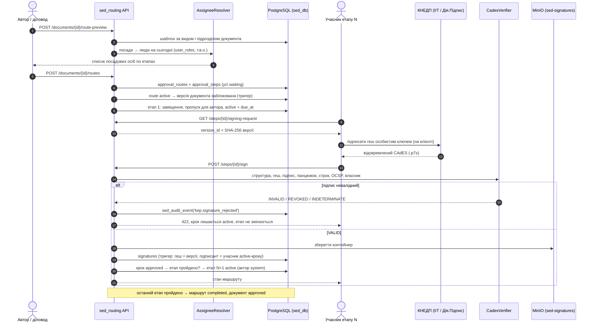
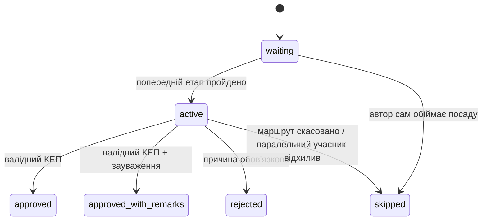
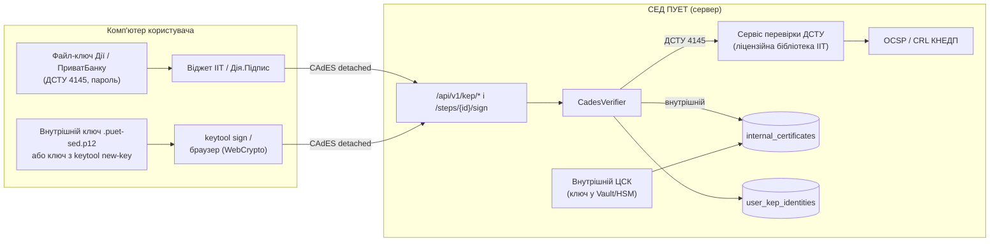

# Маршрутизація погодження з КЕП (Крок 4) і ключі підпису

> **Нове:** файлові ключі КЕП від Дії, ПриватБанку та інших КНЕДП, внутрішній ключ «АІ-СЕД ПУЕТ»,
> перевірка ключів і сертифікатів. Див. [розділ 11](#11-ключі-підпису-дія-приватбанк-внутрішній-ключ-аі-сед-пует).

Сервіс визначає, **які посадові особи мають завізувати документ**, веде маршрут **строго по
етапах** і приймає візу лише з **валідним КЕП**: наступний учасник отримує документ тільки після
того, як попередній успішно завізував. Пакет `sed_routing` працює поверх схеми
[`../db-schema`](../db-schema/README.md) (моделі `sed_db`, тригери історії, аудиту і КЕП) і не
змінює її. Потрібні зміни схеми зібрано в розділі «Запит на зміни схеми БД».

Приклад із завдання налаштовано шаблоном [`templates/memo_procurement.toml`](templates/memo_procurement.toml):

```
Службова записка на закупівлю (MEMO)
  1. Завідувач кафедри            author_unit_head            віза + КЕП
  2. Проректор (за напрямом)      role=vice_rector + напрям   віза + КЕП
  3. Головний бухгалтер           unit_head(BUH)              віза + КЕП
  4. Ректор                       role=rector                 погодження + КЕП
  5. Планово-фінансовий відділ    unit_head(PFV)              віза + КЕП
```

## 1. Схема потоків



Стани:



| Подія | Маршрут | Документ |
|---|---|---|
| запуск | `draft → active` | `draft / revision_required → on_approval` |
| усі обов'язкові кроки етапу позитивні | активується наступний етап | — |
| останній етап пройдено | `completed` | `approved` (`signed`, якщо в маршруті є крок `signing`) |
| відхилено обов'язковим учасником | `rejected` | `revision_required` (нова версія → новий маршрут) |
| скасовано ініціатором/автором | `cancelled` | `on_approval → draft` |

## 2. Структура (Clean Architecture)

```
sed_routing/
  domain/            чиста логіка, без БД і мережі
    state_machine.py   інваріанти етапів: що відбувається після рішення
    resolution.py      посада → людина, заміщення (ланцюжок ≤ 3, без циклів)
    templates.py       шаблони з TOML + валідація
    models.py, errors.py
  kep/               КЕП
    cades.py           ASN.1: збирання й розбір відокремленого CAdES-BES
    verifier.py        8 перевірок, лише VALID закриває крок
    mock.py            імітаційний КНЕДП (справжня криптографія ECDSA P-256)
    ocsp.py            OCSP-перевірка відкликання (RFC 6960)
    models.py          порти TrustStore / RevocationChecker / CertificateBinding
  adapters/          PostgreSQL (sed_db), MinIO, синхронізація шаблонів у БД
  service.py         use cases: preview / create / start / sign / decide / cancel / inbox
  api/               FastAPI, Keycloak JWT
  cli.py             check-templates / sync-templates
templates/           маршрути як конфігурація
openapi.yaml         згенеровано з FastAPI
```

## 3. Шаблони маршрутів

Маршрут описує **посади**, а не прізвища: при запуску резолвер на поточну дату бере людей із
`user_roles` (з т.в.о.), а при активації кожного етапу перевіряє ще раз: якщо за час маршруту
змінився керівник, візує новий, і відповідь містить попередження.

| `rule` | Кого шукає | Параметри |
|---|---|---|
| `author_unit_head` | керівника підрозділу документа (кафедра → `department_head`, інститут → `institute_director`, інше → `unit_head`) | — |
| `unit_head` | керівника вказаного підрозділу | `unit` (код `org_units.code`) |
| `role` | власника ролі; для проректорів напрям збігається з `user_roles.scope_note` | `role`, `role_scope` |
| `author_unit_role` | власника ролі в підрозділі автора або вище по ієрархії | `role` |
| `position_in_unit` | посаду зі штатного розпису | `unit`, `position_code` |
| `specific_user` | конкретну людину | `user_email` |

Кроки без `stage` ідуть строго послідовно; однаковий `stage` у кількох кроків означає паралельне
візування в межах етапу (етап пройдено, коли погодили всі обов'язкові). `skip_if_author = true`
пропускає крок, якщо автор сам обіймає цю посаду (завідувач пише записку від своєї кафедри).

Синхронізація в БД версіонована: змінена структура дає `version + 1`, стара версія деактивується,
а запущені маршрути лишаються на своїй.

```bash
python -m sed_routing.cli check-templates
SED_ROUTING_DATABASE_URL=postgresql+psycopg://... python -m sed_routing.cli sync-templates
```

Коди `BUH`, `PFV` і напрям проректора «з адміністративно-господарської роботи» в прикладі
умовні: їх треба звірити з реальною оргструктурою ПУЕТ. Якщо підрозділу немає, шаблон не
завантажиться і синхронізація повідомить, якого саме коду бракує.

## 4. КЕП: імітація і валідація

**Як підписує клієнт.** Сервер ніколи не бачить особистий ключ. Клієнт отримує
`GET /steps/{id}/signing-request` (SHA-256 версії), підписує у віджеті КНЕДП (ІІТ «Користувач ЦСК»,
Дія.Підпис) і надсилає відокремлений CAdES у `POST /steps/{id}/sign`.

**Що перевіряє `CadesVerifier`** (перша помилка зупиняє решту, крок лишається `active`):

1. розмір (≤ 256 КБ) і структура: CMS SignedData, detached, рівно один підписувач;
2. `message-digest` дорівнює SHA-256 саме тієї версії, що на маршруті;
3. `signing-certificate-v2` збігається з сертифікатом у контейнері (CAdES-BES, захист від підміни сертифіката);
4. математика підпису над `signed attributes` (ECDSA / RSA);
5. сертифікат видав довірений КНЕДП, він кваліфікований (`QcCompliance`) і має `keyUsage` для підпису;
6. строк дії на момент підпису і зараз; `signing-time` не з майбутнього і не раніше, ніж документ надійшов учаснику (заготовлений наперед підпис не пройде);
7. OCSP: `revoked` дає `CERT_REVOKED`, а недоступність дає `INDETERMINATE` (підпис **не** приймається);
8. сертифікат належить учаснику кроку: HMAC РНОКПП із `serialNumber=TINUA-…` збігається із закріпленим за користувачем.

Після VALID контейнер іде в MinIO, рядок у `signatures`. Тригер схеми ще раз звіряє геш і те, що
підписант є учасником активного кроку. Відхилені спроби пишуться в `audit_logs`
(`kep.signature_rejected`) без РНОКПП.

**Імітація** (`kep/mock.py`) видає сертифікати зі структурою кваліфікованих і підписує справжнім
CAdES-BES. Тест `test_container_verifies_with_openssl` незалежно перевіряє контейнер через
`openssl cms -verify`. Імітаційні сертифікати позначені політикою `1.3.6.1.4.1.59999.1.1`.
Верифікатор відкидає їх, якщо `kep_allow_mock=False`, а `Settings` забороняє `kep_allow_mock` у
`production`/`staging`. У dev-режимі є `POST /api/v1/dev/steps/{id}/mock-signature`.

**Реальний КЕП (ДСТУ 4145).** Українські КЕП здебільшого на ДСТУ 4145 з гешем ГОСТ 34.311 /
ДСТУ 7564. Їхню математику виконує сертифікований криптопровайдер (окремий сервіс на бібліотеці
ІІТ або SDK Дія.Підпис), а всю політику (довірений КНЕДП, кваліфікований, строк, власник, час)
застосовує `CadesVerifier`. Без провайдера такий підпис отримує `INDETERMINATE` і не приймається.
Деталі, контракт сервісу та закріплення ключів описано в розділі 11.

## 5. API

| Метод | Шлях | Хто | Що |
|---|---|---|---|
| POST | `/api/v1/documents/{id}/route-preview` | автор, працівник підрозділу | список посадових осіб без збереження |
| POST | `/api/v1/documents/{id}/routes` | те саме | створити і (за замовчуванням) запустити |
| GET | `/api/v1/documents/{id}/route`, `/api/v1/routes/{id}` | ініціатор, автор, учасники | стан, підписи, прострочення |
| POST | `/api/v1/routes/{id}/start`, `/cancel` | ініціатор або автор | запуск чернетки / скасування з причиною |
| GET | `/api/v1/approval-tasks` | будь-хто | мої активні кроки, відсортовані за строком |
| GET | `/api/v1/steps/{id}/signing-request` | учасник активного кроку | що підписувати |
| POST | `/api/v1/steps/{id}/sign` | учасник активного кроку | віза з КЕП |
| POST | `/api/v1/steps/{id}/decision` | учасник активного кроку | відхилення з причиною; погодження лише для кроків без КЕП |

Помилки: `{"detail", "code", ...}`; `409 invalid_state` (етап ще не настав, рішення вже прийнято),
`409 assignee_unresolved` (вакансія або кілька проректорів, з `candidates`),
`409 template_not_selected`, `409 blocking_compliance_findings`, `422 signature_rejected`
(з `validation_status` і `reasons`). Повна специфікація: [`openapi.yaml`](openapi.yaml).

## 6. Запуск і тести

```bash
pip install -r requirements.txt
export PYTHONPATH=.:../db-schema
# PostgreSQL 16 + pgvector; БД перестворюється міграціями ../db-schema
export SED_TEST_DATABASE_URL=postgresql+psycopg://postgres@localhost:5432/sed_routing_test
pytest -q              # 68 passed; без SED_TEST_DATABASE_URL БД-тести пропускаються

# ключі на своєму комп'ютері
python -m sed_routing.keytool inspect privat.jks          # пароль запитається
python -m sed_routing.keytool new-key --key me.key.pem --csr me.csr
python -m sed_routing.keytool sign --key me.puet-sed.p12 doc.pdf --out doc.p7s
python -m sed_routing.keytool verify --sig doc.p7s --ca ca.pem doc.pdf

# dev-сервер з імітаційним КНЕДП
SED_ROUTING_ENVIRONMENT=development SED_ROUTING_KEP_ALLOW_MOCK=true \
SED_ROUTING_KEP_TAX_ID_HMAC_SECRET=$(openssl rand -hex 32) \
SED_ROUTING_DATABASE_URL=postgresql+psycopg://... uvicorn --factory sed_routing.api.app:create_app
```

Тести: `test_domain.py` (машина станів, резолвер, шаблони), `test_kep.py` (18 сценаріїв підробки
підпису, крос-перевірка OpenSSL), `test_service_pg.py` (повний ланцюжок закупівлі з п'ятьма КЕП,
відхилення, заміщення, вакансія, кілька проректорів, критичні зауваження RAG, нова версія під час
погодження, версіонування шаблонів), `test_api.py` (усе через HTTP, подвійне натискання «Підписати»), `test_keys.py` (сертифікати Дії на ДСТУ,
JKS ПриватБанку через Java keytool, PKCS#12, внутрішній ЦСК, CRL, політика рівнів, виклики, keytool з
крос-перевіркою OpenSSL), `test_keys_pg.py` (закріплення ключа Дії, маршрут, завізований ключем Дії,
внутрішнім `.p12` і ключем за CSR; відмова внутрішньому ключу на кроці «лише КЕП»; відкликання; API).

## 7. Граничні випадки

| Випадок | Поведінка |
|---|---|
| Наступний учасник намагається завізувати раніше | `409`: «Етап ще не настав»; DB-тригер підпису теж вимагає `active` крок |
| Подвійне натискання «Підписати» / дві вкладки | блокування документ → маршрут: проходить одна віза, друга дає `409`, зайвий контейнер видаляється з MinIO |
| Посада вакантна | маршрут не створюється (`409 assignee_unresolved`): призначте т.в.о. у `user_roles` або оберіть учасника |
| Кілька проректорів підходять | `409` зі списком `candidates`; ініціатор передає `assignee_overrides`, але лише з тих, хто обіймає цю посаду |
| Автор сам завідувач кафедри | крок `skipped` з поясненням, документ одразу йде проректору |
| Відпустка / відрядження | `delegations` на дату активації етапу: віза переходить заступнику, `original_assignee_id` зберігається; цикл заміщень і звільнений заступник ігноруються |
| Керівника змінили посеред маршруту | при активації етапу візує чинний керівник + попередження |
| Під час погодження завантажили нову версію | рішення блокуються (`409`), маршрут треба скасувати й запустити на новій версії |
| Підпис іншого документа, чужий ключ, прострочений/відкликаний сертифікат, підпис «наперед» | `422`, крок лишається активним, спроба в аудиті |
| OCSP недоступний | `INDETERMINATE`, віза не приймається (fail-closed) |
| Відкриті критичні зауваження RAG-аудиту | запуск блокується; свідоме підтвердження `acknowledge_findings` пишеться в аудит |
| Вид документа `UNSORTED` (ШІ не впевнений, confidence < 0.85) | маршрут не запускається, доки людина не уточнить вид |
| Сервісний акаунт ШІ (`sed-ai-service`) | `403` на всіх діях погодження; другий рубіж — тригер `sed_guard_legal_decisions` |
| Необов'язковий учасник відхилив | це зауваження, маршрут іде далі; незакритий необов'язковий крок закривається разом з етапом |

## 8. Ризики безпеки і як їх нівельовано

- **Підміна документа після візи.** Віза прив'язана до SHA-256 конкретної версії; версія блокується з запуском маршруту, тригер не дає змінити її вміст.
- **Підміна підписанта.** Сертифікат прив'язується до користувача через HMAC РНОКПП; сам РНОКПП не зберігається (ЗУ «Про захист персональних даних»). Секрет HMAC (≥ 32 байти) має бути у Vault.
- **Імітаційний підпис у продуктиві.** Заборонено на трьох рівнях: `Settings`, політика сертифіката, довірені корені.
- **DoS через великі контейнери.** Ліміт розміру до розбору ASN.1, суворий DER-парсинг.
- **Повторне використання підпису.** Унікальність `(версія, підписант, крок)` у БД, перевірка `signing-time ≥ activated_at`.
- **Рішення ШІ.** ШІ не може ні візувати, ні підписувати (сервіс + тригер БД). Майбутня AI-пропозиція маршруту (`origin = ai_suggested`) лише пропонує, а людина запускає.
- **Mass assignment.** Вхідні DTO з `extra="forbid"`.
- **Заявлений час підпису.** Без TSP `signing-time` заявляє сам підписувач; для продуктиву потрібен CAdES-X-Long з кваліфікованою позначкою часу.

## 9. Запит на зміни схеми БД (для треду «Схема БД для СЕД»)

Сервіс працює на поточній схемі плюс `schema_proposal/0003_kep_keys.sql`. Поля 1–2 тимчасово
беруться з TOML-каталогу; тригери 4–5 продублюють у БД перевірки, які зараз робить сервіс.

```sql
-- 1. Назва посади, напрям проректора і пропуск для автора — у самому шаблоні
ALTER TABLE route_template_steps
    ADD COLUMN title_uk       varchar(256),
    ADD COLUMN role_scope     varchar(64),            -- код напряму, напр. 'ahr', 'academic'
    ADD COLUMN skip_if_author boolean NOT NULL DEFAULT false;

-- 2. Стабільний код напряму замість вільного тексту scope_note
ALTER TABLE user_roles ADD COLUMN scope_code varchar(64);
CREATE INDEX ix_user_roles_role_scope ON user_roles (role, scope_code);

-- 3. Ключі КЕП і внутрішній ЦСК: повний DDL у schema_proposal/0003_kep_keys.sql
--    (user_kep_identities, internal_certificates, kep_key_level, signature_provider += 'sed_internal_key').
--    Тести і sed-app накочують цей файл поверх міграцій 0001–0002.

-- 4. Послідовність на рівні БД: крок не стає active, поки не пройдено попередні етапи
CREATE FUNCTION sed_step_sequence_guard() RETURNS trigger LANGUAGE plpgsql AS $$
BEGIN
    IF NEW.status = 'active' AND OLD.status IS DISTINCT FROM 'active' AND EXISTS (
        SELECT 1 FROM approval_steps p
         WHERE p.route_id = NEW.route_id AND p.stage_no < NEW.stage_no AND p.is_mandatory
           AND p.status NOT IN ('approved','approved_with_remarks','skipped')) THEN
        RAISE EXCEPTION 'step % cannot be activated before previous stages are approved', NEW.id
            USING ERRCODE = 'check_violation';
    END IF;
    IF NEW.status IN ('approved','approved_with_remarks','rejected') AND OLD.status <> 'active' THEN
        RAISE EXCEPTION 'only an active step can be decided (step %, status %)', NEW.id, OLD.status
            USING ERRCODE = 'check_violation';
    END IF;
    RETURN NEW;
END $$;
CREATE TRIGGER trg_approval_steps_sequence BEFORE UPDATE OF status ON approval_steps
    FOR EACH ROW EXECUTE FUNCTION sed_step_sequence_guard();

-- 5. Крок із requires_kep не можна погодити без валідного підпису на ньому
CREATE FUNCTION sed_step_requires_signature() RETURNS trigger LANGUAGE plpgsql AS $$
BEGIN
    IF NEW.requires_kep AND NEW.status IN ('approved','approved_with_remarks')
       AND NOT EXISTS (SELECT 1 FROM signatures s
                        WHERE s.approval_step_id = NEW.id AND s.signer_id = NEW.assignee_id
                          AND s.validation_status = 'valid') THEN
        RAISE EXCEPTION 'step % requires a valid KEP of its assignee', NEW.id
            USING ERRCODE = 'check_violation';
    END IF;
    RETURN NEW;
END $$;
CREATE TRIGGER trg_approval_steps_requires_kep BEFORE UPDATE OF status ON approval_steps
    FOR EACH ROW EXECUTE FUNCTION sed_step_requires_signature();
```

Після цих змін `TemplateCatalog` лишиться лише джерелом для синхронізації. SQL-адаптер над
`user_kep_identities` уже є (`adapters/sql_kep.py`); `kep_bindings_file` залишено для сумісності.

Ще два пункти для власника схеми, з розділу 11:

```sql
-- 6. Рівень підпису кроку — у шаблоні, а не лише в TOML
ALTER TABLE route_template_steps
    ADD COLUMN signature_levels kep_key_level[] NOT NULL DEFAULT '{qualified}'
    CHECK (step_kind <> 'signing' OR signature_levels = '{qualified}');
-- 7. Рівень і постачальник у самому підписі (зараз рівень — у validation_report.level,
--    provider = 'file_key'; після 0003 внутрішні підписи писатимуться як 'sed_internal_key')
ALTER TABLE signatures ADD COLUMN signature_level kep_key_level;
```

## 10. Що далі

- Розгорнути сервіс перевірки ДСТУ на ліцензійній бібліотеці ІІТ за контрактом розділу 11.3; CAdES-X-Long з TSP.
- AI-пропозиція маршруту (`ai_runs.task_type = route_suggestion`): для документів без однозначного шаблону; людина підтверджує.
- Умовні кроки за реквізитами (наприклад, сума закупівлі понад поріг додає тендерний комітет).
- Робочі години і святкові дні для `due_at`, нагадування й ескалації (сировина для виявлення аномалій уже в `approval_step_history`).

## 11. Ключі підпису: Дія, ПриватБанк, внутрішній ключ АІ-СЕД ПУЕТ

### 11.1. Два рівні підпису

| Рівень | Звідки ключ | Юридична сила | Де приймається |
|---|---|---|---|
| `qualified` — КЕП | файл-ключ Дії (`Key-6.dat`, `.pfx`), ПриватБанку (`.jks`), іншого КНЕДП; токен; хмарний КЕП | так (ЗУ «Про електронну ідентифікацію та електронні довірчі послуги») | будь-який крок; крок `signing` лише такий |
| `internal` — внутрішній ключ | внутрішній ЦСК «АІ-СЕД ПУЕТ» (файл `.puet-sed.p12` або CSR) | **не КЕП**; діє лише всередині СЕД ПУЕТ за наказом ректора / положенням про ЕДО | лише кроки, де шаблон дозволяє `signature_levels = ["qualified", "internal"]` |

Внутрішній ключ не можна використати для документів назовні (ЄДЕБО, контрагенти, казначейство,
суди) і для кроку `signing`: валідатор шаблону це забороняє, а сервіс відхиляє такий підпис
повідомленням «Цей крок вимагає кваліфікованого КЕП…». У шаблоні службової записки на закупівлю
внутрішній ключ дозволено на всіх п'яти візах (це внутрішній документ). Якщо положення ПУЕТ цього
не передбачає, приберіть `"internal"` з `templates/memo_procurement.toml`.

### 11.2. Схема



Особистий ключ і пароль до файлу-ключа **ніколи не передаються на сервер**: підписують віджет КНЕДП
або `keytool` на комп'ютері користувача. Ендпоінт перевірки сертифіката відмовляє (`422
private_key_upload_refused`), якщо йому надіслали файл з особистим ключем.

### 11.3. КЕП Дії та ПриватБанку

1. **Закріплення ключа (один раз).** `POST /kep/challenges` видає одноразовий виклик (HMAC-токен,
   10 хв, прив'язаний до користувача). Користувач підписує його своїм ключем у віджеті і надсилає в
   `POST /kep/keys`. Сервер перевіряє підпис, бере з сертифіката РНОКПП (`serialNumber=TINUA-…` або
   DRFO у `subjectDirectoryAttributes`), звіряє ПІБ із карткою користувача і записує закріплення
   (`user_kep_identities`, РНОКПП лише як HMAC). Повторна реєстрація того самого ключа нічого не
   дублює; ключ, закріплений за іншою особою, і другий РНОКПП відхиляються. Перевипущений у КНЕДП
   сертифікат тієї ж особи приймається за збігом HMAC РНОКПП.
2. **Візування.** Як і раніше, через `signing-request` → `sign`. Для ДСТУ-підпису сервіс читає файл
   версії з MinIO (`DocumentContentReader`), звіряє його SHA-256 з версією на маршруті і передає
   контейнер разом із вмістом у сервіс перевірки ДСТУ. Решту політики (довірений КНЕДП за AKI/SKI,
   кваліфікований, строк, час, власник) застосовує `CadesVerifier`.
3. **Сервіс перевірки ДСТУ (sidecar).** Ліцензійну бібліотеку ІІТ «EUSignCP» (або SDK Дія.Підпис)
   розгортають окремим контейнером у внутрішній мережі (`SED_ROUTING_KEP_DSTU_VERIFIER_URL`).
   Контракт:

   ```
   POST /v1/verify-detached  {"signature_base64": "...", "data_base64": "..."}
   → {"valid": true, "reasons": [], "signer_certificate_base64": "...", "signing_time": "...",
      "timestamp_time": "...", "revocation": "good|revoked|unknown", "chain_valid": true,
      "signature_format": "CAdES-BES|CAdES-X-Long"}
   ```

   Поки сервісу немає, ДСТУ-підписи отримують `INDETERMINATE` і **не приймаються**. Тести
   використовують `tests/dstu_fake.py`: справжня ASN.1-структура сертифікатів Дії (OID ДСТУ, РНОКПП,
   QcCompliance, AKI/SKI) і фейковий провайдер замість математики ДСТУ.

**Перевірка ключа на комп'ютері (`keytool inspect`)** розпізнає формат, перевіряє пароль і
відповідність ключа сертифікату:

| Формат | Від кого | Що перевіряється без бібліотеки ІІТ |
|---|---|---|
| JKS (`.jks`) | ПриватБанк | пароль (MAC сховища і KeyProtector), сертифікати, відповідність ключа |
| PKCS#12 (`.pfx`, `.p12`) | Дія, інші КНЕДП, внутрішній ЦСК | пароль (MAC за RFC 7292), сертифікати; для ECDSA/RSA ще й ключ |
| `Key-6.dat` | ІІТ / КНЕДП ДПС | лише розпізнавання формату; пароль перевіряє віджет ІІТ |
| сертифікат (`.cer`, `.crt`, `.pem`) | будь-хто | власник, КНЕДП, строк, РНОКПП (маскований), keyUsage |

На сервері: `POST /kep/certificates/inspect` (лише сертифікат) і `POST /kep/signatures/verify`
(будь-який підпис над SHA-256, без прийняття візи).

### 11.4. Внутрішній ключ «АІ-СЕД ПУЕТ»

- **ЦСК.** `keytool ca-init` створює кореневий ЦСК (P-384, 10 років; ключ переноситься на офлайн-носій)
  і видавальний ЦСК (P-256, 5 років; ключ зашифрований, на сервері з Vault/HSM). Сертифікати мають
  політику `1.3.6.1.4.1.59999.2.1` з приміткою «Не є КЕП», EKU `documentSigning`, UID = ідентифікатор
  користувача СЕД, ПІБ і підрозділ з облікового запису (суб'єкт із CSR ігнорується), строк 1 рік.
- **Видача, спосіб А (рекомендовано).** `keytool new-key` генерує ключ на комп'ютері користувача,
  `POST /kep/internal/certificates/csr` повертає сертифікат. Сервер бачить лише відкритий ключ.
- **Видача, спосіб Б.** `POST /kep/internal/key-file` з паролем користувача: сервер генерує ключ,
  одразу шифрує його в PKCS#12 (AES-256-CBC, PBKDF2-SHA256 на 600 000 ітерацій, MAC HMAC-SHA256) і
  віддає один раз (`Cache-Control: no-store`). Копії ключа і пароля на сервері немає. Пароль: не
  менше 12 символів, три класи символів, без імені, прізвища чи пошти.
- **Один чинний ключ.** Новий випуск відкликає попередній (`superseded`). Відкликання власником або
  роллю `sed-kep-admin` (`POST /kep/internal/certificates/{serial}/revoke`, `POST /kep/keys/{id}/revoke`).
  Статус перевіряється за реєстром `internal_certificates` при кожному підписі; CRL для зовнішніх
  перевірок: `GET /kep/internal/crl`, ланцюжок: `GET /kep/internal/ca.pem`.
- **Підпис** тим самим CAdES-BES (ECDSA P-256 / SHA-256): `keytool sign` або браузер. Незалежно
  перевіряється `openssl cms -verify` (тест `test_keytool_end_to_end`).

### 11.5. API ключів

| Метод і шлях | Що робить |
|---|---|
| `POST /api/v1/kep/challenges` | виклик для доказу володіння ключем |
| `POST /api/v1/kep/keys` | закріпити КЕП (підпис виклику) |
| `GET /api/v1/kep/keys` | мої ключі (рівень, строк, `expires_soon` за 30 днів) |
| `POST /api/v1/kep/keys/{id}/revoke` | відкріпити ключ |
| `POST /api/v1/kep/certificates/inspect` | перевірити сертифікат (multipart `file`) |
| `POST /api/v1/kep/signatures/verify` | перевірити підпис над SHA-256 |
| `POST /api/v1/kep/internal/certificates/csr` | внутрішній сертифікат за CSR |
| `POST /api/v1/kep/internal/key-file` | внутрішній файл-ключ `.puet-sed.p12` |
| `POST /api/v1/kep/internal/certificates/{serial}/revoke` | відкликати внутрішній сертифікат |
| `GET /api/v1/kep/internal/ca.pem`, `GET /api/v1/kep/internal/crl` | ланцюжок і CRL внутрішнього ЦСК |

`GET /steps/{id}/signing-request` тепер також повертає `accepted_levels` / `accepted_levels_uk`.

### 11.6. Граничні випадки

- ДСТУ-підпис без сервісу перевірки або з недоступним сервісом: `INDETERMINATE`, віза не приймається, крок лишається активним.
- Файл у сховищі не збігається з гешем версії: `INDETERMINATE` (не перекладаємо провину на підписувача).
- Сертифікат КНЕДП поза Довірчим списком (AKI не збігається з SKI довіреного ЦСК, або провайдер каже `chain_valid=false`): `INVALID`.
- Відкликаний сертифікат (OCSP КНЕДП або реєстр внутрішніх): `CERT_REVOKED`; невідомий статус: `INDETERMINATE`.
- Внутрішній сертифікат, якого немає в реєстрі (наприклад, з іншої інсталяції або підроблений ЦСК): `INVALID`.
- Внутрішній ключ іншого користувача (UID ≠ учасник кроку): `INVALID`.
- Сертифікат без РНОКПП (печатка, деякі ключі юросіб): закріпити не можна.
- ПІБ у сертифікаті не збігається з карткою (зміна прізвища): закріплення відхиляється; вимикається `SED_ROUTING_KEP_REQUIRE_NAME_MATCH=false` після звірки кадровиком.
- Виклик протермінований, чужий або підписаний інший вміст: закріплення відхиляється.
- Повторне натискання «Отримати файл-ключ»: попередній ключ стає `superseded`, дійсним лишається тільки останній.

### 11.7. Ризики безпеки

| Ризик | Як нівельовано |
|---|---|
| Витік файл-ключа КЕП або пароля через сервер | сервер їх не приймає; inspect відмовляє на файлі з ключем; підписують віджет або `keytool` локально |
| Хтось закріплює чужий ключ | доказ володіння (підпис одноразового виклику), збіг ПІБ, РНОКПП як HMAC, унікальність активного відбитка в БД |
| Внутрішній ключ видають за КЕП | окрема політика й примітка в сертифікаті, рівень у `validation_report`, `signing` лише з КЕП, політика на кожному кроці |
| Компрометація видавального ЦСК | кореневий ключ офлайн; видавальний у Vault/HSM, зашифрований; перевипуск видавального й масове відкликання за реєстром |
| Перехоплення згенерованого `.p12` | віддається один раз, `no-store`, сильне шифрування; рекомендовано CSR-спосіб |
| Перебір пароля до `.p12` | PBKDF2 600 000 ітерацій, політика пароля |
| Підміна відповіді сервісу ДСТУ | сервіс лише у внутрішній мережі (mTLS у продуктиві), відбиток сертифіката у відповіді звіряється з контейнером, геш вмісту звіряється з версією |
| Персональні дані | РНОКПП у відповідях і `subject` маскується (`******1234`), у БД лише HMAC |
| Пароль у історії shell | `keytool` бере пароль зі змінної, файлу або запиту, не з аргументів; ключі пишуться з правами 600 |

### 11.8. Налаштування

| Змінна `SED_ROUTING_…` | Призначення |
|---|---|
| `KEP_CHALLENGE_SECRET` | ≥ 32 байт, обов'язкова в production/staging |
| `KEP_REGISTRY_SQL` | реєстр ключів у БД (за замовчуванням `true`) |
| `KEP_DSTU_VERIFIER_URL` | адреса сервісу перевірки ДСТУ |
| `KEP_REQUIRE_NAME_MATCH`, `KEP_ADMIN_ROLE` | звірка ПІБ; роль адміністратора ключів |
| `INTERNAL_CA_ENABLED`, `INTERNAL_CA_KEY_PEM`, `INTERNAL_CA_KEY_PASSWORD`, `INTERNAL_CA_CHAIN_PEM`, `INTERNAL_CA_VALIDITY_DAYS`, `INTERNAL_CA_PUBLIC_URL` | внутрішній ЦСК |

### 11.9. Нові файли

```
sed_routing/key_service.py        KeyManagementService: виклики, закріплення, видача й відкликання
sed_routing/keytool.py            офлайн-утиліта: inspect, new-key, sign, verify, ca-init
sed_routing/api/key_routes.py     /api/v1/kep/*
sed_routing/kep/certinfo.py       розбір сертифікатів (зокрема ДСТУ), рівні, маскування РНОКПП
sed_routing/kep/keyfile.py        розпізнавання й перевірка файл-ключів (JKS, PKCS#12, Key-6.dat)
sed_routing/kep/internal_ca.py    внутрішній ЦСК
sed_routing/kep/registry.py       реєстри ключів (порти + пам'ять), RegistryBinding
sed_routing/kep/challenge.py      виклики для доказу володіння
sed_routing/kep/external.py       контракт сервісу перевірки ДСТУ
sed_routing/adapters/sql_kep.py   реєстри в PostgreSQL
schema_proposal/0003_kep_keys.sql DDL для власника схеми
tests/test_keys.py, tests/test_keys_pg.py, tests/dstu_fake.py
```

## 12. Що змінити в sed-app (веб-інтерфейс)

Бекенд sed-app уже підключає `key_routes` і `app.state.keys` (через `create_app` модуля), а міграція
`sed_app/cli/migrate.py` накочує `0003_kep_keys.sql`, тож API доступне без змін коду. Для інтерфейсу:

1. Сторінка «Мої ключі»: список (`GET /kep/keys`) з рівнем, строком і позначкою «спливає»; кнопка «Відкріпити».
2. «Додати КЕП (Дія / ПриватБанк)»: віджет ІІТ «Підписати файл» над `data_base64` з `POST /kep/challenges`, далі `POST /kep/keys`. Файл-ключ обирається у віджеті й не завантажується на сервер.
3. «Отримати внутрішній ключ»: форма пароля → `POST /kep/internal/key-file` → завантаження `.puet-sed.p12`; або вставка CSR. Чітке попередження «Не є КЕП, діє лише в СЕД ПУЕТ».
4. «Перевірити сертифікат / підпис»: завантаження `.cer` у `/kep/certificates/inspect`, `.p7s` + файл у `/kep/signatures/verify` (геш рахувати в браузері).
5. Вікно візування: показувати `accepted_levels_uk` з `signing-request`; для внутрішнього ключа підписувати в браузері (WebCrypto ECDSA P-256 над `signed attributes`) або пропонувати `keytool sign`.
6. Налаштування: `SED_ROUTING_KEP_CHALLENGE_SECRET`, `SED_ROUTING_INTERNAL_CA_*`, `SED_ROUTING_KEP_DSTU_VERIFIER_URL` у `deploy/` і `docker-compose.yml`; сервіс перевірки ДСТУ окремим контейнером.
