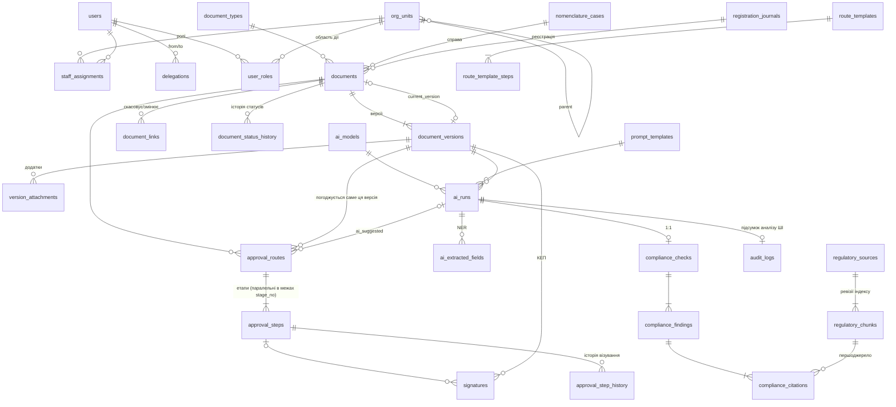

# Схема БД СЕД ПУЕТ (модуль DB Schema)

PostgreSQL 16 + pgvector, SQLAlchemy 2.0 (typed declarative), Pydantic v2, Alembic. Охоплює
користувачів з ролями, документи з версійністю, маршрути візування та історію статусів
погодження, КЕП, журнал запусків ШІ, логи комплаєнс-перевірок і `audit_logs`, куди
записуються результати аналізу ШІ (confidence score, виявлені порушення, вилучені метадані).

Перевірено на живому PostgreSQL 16: `upgrade → downgrade → upgrade`, `alembic check`
(моделі = міграція), 29 тестів зелені (23 інтеграційні на БД + 6 юніт-тестів Pydantic); з цією схемою
зелені й 81 тест конвеєра завантаження `../ingest-pipeline`.

## Склад

| Шлях | Що це |
|---|---|
| `sed_db/base.py` | Декларативна база, конвенція іменування обмежень, UUID-PK, поріг `0.85` |
| `sed_db/enums.py` | Перелічення домену + українські підписи для UI |
| `sed_db/models/org.py` | Оргструктура, користувачі (проєкція Keycloak), ролі `user_roles`, посади, заміщення |
| `sed_db/models/documents.py` | Види документів, номенклатура справ, журнали реєстрації, документи, версії, додатки, зв'язки |
| `sed_db/models/routing.py` | Шаблони маршрутів (версіоновані), екземпляри маршрутів / кроків, історія статусів документа й кроків |
| `sed_db/models/signatures.py` | КЕП / Дія.Підпис над версією |
| `sed_db/models/ai.py` | Моделі, промпти, `ai_runs`, NER-реквізити, нормативний корпус RAG, комплаєнс-логи |
| `sed_db/models/audit.py` | `audit_logs`: зміни, бізнес-події та результати аналізу ШІ під хеш-ланцюжком |
| `sed_db/schemas/` | Pydantic v2 DTO для FastAPI: `*Create`/`*In` з бізнес-валідацією, `*Read` з ORM |
| `sed_db/ddl.py` | Тригери, guard-и та функції PostgreSQL (те, що ORM не виражає) |
| `migrations/versions/0001_initial_schema.py` | Початкова міграція Alembic |
| `migrations/versions/0002_seed_reference_data.py`, `sed_db/seeds/` | Довідкові дані: службовий користувач, 12 видів документів, промпт інжесту |
| `schema.sql` | Повний DDL (`pg_dump --schema-only`) для рев'ю |
| `roles.sql` | Ролі БД з найменшими привілеями (`sed_app`, `sed_ai_worker`, `sed_auditor`) |
| `openapi.yaml` | Контракт AI-воркер → Core API для запису результатів ШІ |
| `tests/` | Інтеграційні тести інваріантів БД і юніт-тести схем |

## ER-діаграма (спрощено)



## Потік документа і де стоять запобіжники

```
draft ──► ai_review ──► draft ──► on_approval ──► approved ──► signed ──► registered ──► in_execution ──► executed ──► archived
          (ШІ може                  │ версія          │                │ лише з валідним  │ sed_register_document():
           лише сюди                │ блокується      │                │ КЕП на поточній  │ номер без пропусків
           і назад)                 ▼                 ▼                │ версії           │
                              revision_required   cancelled            ▼
                                                              current_version заморожено
```

## Ролі користувачів

`user_roles` зберігає функціональні ролі з областю дії та строком (дзеркало Keycloak realm roles):

| Роль (`user_role`) | Підпис у UI | Область дії | Одночасно одна особа |
|---|---|---|---|
| `student` | Студент | підрозділ (обов'язково) | ні |
| `lecturer` | Викладач | підрозділ | ні |
| `department_head` | Завідувач кафедри | кафедра (вид `department`) | так |
| `institute_director` | Директор інституту | інститут (вид `institute`) | так |
| `unit_head` | Керівник структурного підрозділу | підрозділ | так |
| `rector` | Ректор | університет (`org_unit_id` порожній) | так |
| `vice_rector` | Проректор | університет, напрям у `scope_note` | ні |
| `staff` | Співробітник | підрозділ | ні |
| `student_government_head` | Голова студентського самоврядування | університет або інститут | так |

Людина може мати кілька ролей (викладач + завідувач). Перетин строків двох керівників одного
підрозділу або дубль ролі блокує EXCLUDE-обмеження; вид підрозділу для завідувача/директора
перевіряє тригер. Маршрути адресують кроки ролям (`assignee_rule = role` або `author_unit_role`,
наприклад «директор інституту автора»), а крок фіксує `acting_role`: у якій якості людина візує.
`staff_assignments` лишається для кадрових посад зі штатного розпису і прав у СЕД не дає.

## Історія статусів погодження

* `document_status_history`: кожен перехід статусу документа (з якого, в який, хто, тип актора,
  версія, маршрут, причина з `set_config('sed.change_reason', …)`).
* `approval_step_history`: кожна зміна статусу кроку візування з коментарем і роллю.

Обидві таблиці заповнюють тригери (застосунок не може «забути» запис чи підробити його),
обидві append-only.

## audit_logs і результати ШІ

Один журнал, три категорії: `data_change` (диф змін 15 ключових таблиць), `business_event`
(перегляд, експорт) і `ai_analysis`. Запис `ai_analysis` створює відкладений тригер на COMMIT
транзакції, у якій запуск ШІ отримав статус `succeeded`, тому в ньому вже є всі дані:

| Стовпець | Вміст |
|---|---|
| `confidence_score`, `requires_human_review` | Впевненість запуску і чи потрібна ручна валідація (< 0.85) |
| `ai_verdict` | Вердикт комплаєнсу або клас документа |
| `violations` | Масив порушень: серйозність, категорія, впевненість, цитати-першоджерела |
| `extracted_metadata` | Вилучені реквізити з впевненістю; ПД (`"x-pii": true` у схемі виду) лише замасковано |
| `ai_model`, `ai_task_type`, `ai_run_id` | Яка модель і яка задача, посилання на повний запуск |

Ці поля входять у хеш запису: змінити confidence чи викреслити порушення непомітно не вийде
(перевірено тестом). Детальні робочі дані (окремі зауваження зі статусами, NER-поля з
валідацією оператора) лишаються в `compliance_*` та `ai_extracted_fields`, `audit_logs` — це
незмінний знімок «що сказав ШІ в момент аналізу».

## Довідкові дані (міграція 0002)

* **Види документів:** `ORDER_MAIN`, `ORDER_PERSONNEL`, `ORDER_STUDENTS`, `DIRECTIVE`, `APPLICATION`,
  `MEMO`, `REPORT_MEMO`, `EXPLANATORY_NOTE`, `LETTER`, `PROTOCOL`, `REGULATION` і `UNSORTED`
  (вид за замовчуванням для документів, які не вдалося впевнено класифікувати; гриф `restricted`,
  перед погодженням вид треба уточнити). Накази о/с, щодо контингенту та заяви мають гриф
  `personal_data` за замовчуванням.
* **`requisites_schema`** кожного виду: JSON Schema реквізитів за ДСТУ 4163:2020; `author` і
  `interested_parties` позначено `"x-pii": true`, тож у `audit_logs.extracted_metadata` вони лише замасковані.
* **Промпт** `ingest.requisites_dstu4163` v1 (текст у `sed_db/seeds/`, хеш зафіксовано) від
  службового користувача «Система СЕД» (неактивний, не може увійти чи візувати).
* Накат ідемпотентний (`ON CONFLICT DO NOTHING`), правки адміністратора в довіднику не перезаписуються.
  Тест звіряє коди видів, ключі ПД і хеш промпту з константами `ingest-pipeline`, якщо він лежить поруч.

## Ключові рішення

1. **Версія незмінна.** Редагування = новий рядок `document_versions`. Тригер забороняє міняти
   вміст (ключ у MinIO, SHA-256, розмір) будь-якої версії, а заблоковану не можна видалити чи
   розблокувати. Версія блокується автоматично при активації маршруту або першому КЕП.
2. **Погоджується конкретна версія.** `approval_routes` має складений FK
   `(document_version_id, document_id)`, тож маршрут не може посилатися на версію чужого документа;
   те саме для `documents.current_version_id`. На документ не більше одного відкритого маршруту.
3. **КЕП прив'язаний до байтів.** Тригер вимагає `signed_content_sha256 = content_sha256` версії,
   підписант має бути виконавцем активного кроку. Рядок підпису змінюється лише в полях валідації
   (OCSP/CRL), видалення заборонене.
4. **Human-in-the-loop в БД, а не лише в коді:**
   - `confidence < confidence_threshold` → CHECK забороняє `human_review_status = 'not_required'`;
     поріг не можна знизити нижче `0.85`; `requires_human_review` — згенерований стовпець;
   - єдина черга оператора: `ai_runs WHERE human_review_status = 'pending'` (частковий індекс);
   - guard-тригер: актор `ai_service` (або роль БД `sed_ai_worker`) не може змінити статус
     документа далі за `ai_review`, вирішити крок маршруту, підтвердити власну перевірку,
     закрити зауваження чи створити підпис;
   - статус `signed` можливий лише за наявності **валідного** КЕП на поточній версії.
5. **PII.** LLM-задачі (класифікація, NER, комплаєнс, маршрутизація, генерація) не збережуться без
   `pii_masked = true`. Сирий вхід моделі не зберігається, лише його SHA-256. РНОКПП підписанта
   зберігається тільки як HMAC.
6. **Відтворюваність ШІ.** Кожен запуск фіксує модель (назва, версія, дайджест ваг), версію промпта
   (незмінна таблиця), параметри, токени, затримку. Комплаєнс-перевірка фіксує дату, на яку
   оцінювалась чинність норм (`regulations_as_of`), і конфіг гібридного пошуку.
7. **Цитати не «зависають» і не галюцинують.** Фрагменти корпусу незмінні, переіндексація створює
   нову `index_revision`; цитата зберігає знімок тексту, статус акта на момент перевірки та
   прапорець `quote_verified` (буквальна перевірка входження цитати у фрагмент).
8. **Гібридний пошук у PostgreSQL:** `tsvector` + GIN (sparse) і `vector(1024)` + HNSW з
   `vector_cosine_ops` (dense) у `regulatory_chunks`. Якщо оберете Qdrant, стовпець `embedding`
   прибирається, а `id` фрагмента стає `point_id` у Qdrant.
9. **Аудит з доказом цілісності.** Тригер на 15 ключових таблицях пише диф змін в `audit_logs`
   (без великих полів). Кожен запис має `chain_seq` і `record_hash = sha256(prev_hash || запис)`;
   `sed_audit_verify()` знаходить перший підроблений чи пропущений запис, навіть якщо DBA вимкнув
   тригер. Прямий запис у журнал ролям застосунку заборонено, лише через тригери та
   `sed_audit_event()` (перегляд, експорт, завантаження).
10. **Реєстрація без дірок.** `sed_register_document()` інкрементує лічильник журналу під рядковим
    lock-ом: відкат транзакції повертає номер, тож номери наказів ідуть підряд, як вимагає діловодство.

## Pydantic-схеми

`sed_db/schemas/` дублюють критичні інваріанти БД, щоб API повертав зрозумілу помилку 422
українською ще до запиту в БД: область дії ролі, маскування ПД для LLM-задач, межі
confidence, хоча б одна перевірена цитата на зауваження, коментар при відхиленні візи,
порядок «візи → підпис» у шаблоні маршруту, дозволені переходи статусів (`ALLOWED_TRANSITIONS`).
Вхідні моделі мають `extra="forbid"`, вихідні будуються з ORM (`from_attributes`).
`AiRunResult` приймає реквізити й перевірку разом із завершенням запуску: тоді все пишеться
однією транзакцією, і підсумок у `audit_logs` повний.

## Як підключити до застосунку

```python
# на початку кожної транзакції (FastAPI dependency)
await session.execute(text(
    "SELECT set_config('sed.actor_user_id', :u, true),"
    "       set_config('sed.actor_type', :t, true),"
    "       set_config('sed.request_id', :r, true)"
), {"u": str(user.id), "t": "user", "r": request_id})
```

Усі зв'язки ORM мають `lazy="raise"`: під async-сесією неявне довантаження заборонене,
використовуйте `selectinload(...)`. `documents.row_version` — оптимістичне блокування
(конкурентне редагування картки дає `StaleDataError`, а не тихе перезаписування).

## Запуск

```bash
pip install -r requirements.txt
export SED_DATABASE_URL=postgresql+psycopg://sed_owner:***@db/sed
alembic upgrade head
psql "$SED_DATABASE_URL" -f roles.sql          # один раз, від DBA

# тести (окрема БД, буде перестворена)
export SED_TEST_DATABASE_URL=postgresql+psycopg://postgres@localhost/sed_test
pytest -q tests
```

Потрібні розширення: `pgcrypto`, `pg_trgm`, `btree_gist`, `vector` (пакет `postgresql-16-pgvector`).

## Граничні випадки і ризики

| Ситуація | Як закрито |
|---|---|
| Підміна файлу після підпису | Хеш версії незмінний, КЕП звіряється з хешем, `current_version_id` заморожено після `signed` |
| ШІ «погодив» документ | Guard-тригер + роль `sed_ai_worker` без прав; юридична сила лише через КЕП людини |
| Низька впевненість NER/комплаєнсу | CHECK не дає зберегти без черги ручної валідації; оператор фіксується (`reviewed_by_id`) |
| Відпустка погоджувача | `delegations` + у кроці зберігаються `original_assignee_id` і `delegation_id` |
| Два завідувачі кафедри одночасно | EXCLUDE-обмеження на перетин періодів `is_head` |
| Зміна регламенту після перевірки | Знімок цитати й статусу акта; стара ревізія фрагментів лишається |
| Переіменування / реорганізація підрозділу | Підрозділи не видаляються (`RESTRICT`), є `valid_from/valid_to` |
| Хибне відхилення зауваження ШІ | `dismissed` вимагає обґрунтування; видно, хто і коли |
| Валідація КЕП і зміна статусу в одній транзакції | Спершу зберегти `validation_status = 'valid'`, потім статус документа (ORM сам цього порядку не гарантує, тест це фіксує) |
| Результати ШІ записали в іншій транзакції, ніж завершення запуску | Підсумок `audit_logs` був би без порушень; тому API приймає все одним `AiRunResult` |
| Персональні дані в журналі аудиту | Диф містить метадані (заголовки можуть мати ПІБ): доступ лише `sed_auditor`, текст версій аудитору закрито |
| Навантаження на ланцюг аудиту | Записи серіалізуються advisory-lock-ом до COMMIT. Для масштабу ЗВО достатньо; якщо стане вузьким місцем — перейти на асинхронне «запечатування» ланцюга одним воркером |
| Ріст `audit_logs` / `ai_runs` | BRIN-індекс за часом; наступний крок — декларативне партиціювання за місяцями (pg_partman) |
| Відсутність українського словника FTS | Використано конфіг `simple` + `pg_trgm`; можна підключити hunspell `uk_UA` і замінити конфіг без зміни схеми |
| Фіксація хвоста ланцюга аудиту | Рекомендовано щодоби підписувати `record_hash` останнього запису печаткою ПУЕТ (КЕП) і зберігати поза БД |

## Що далі

- Row-Level Security за `access_level` і підрозділом (атрибути з Keycloak → `set_config`), для ABAC.
- Таблиці доручень / контролю виконання (`resolutions`, `tasks`) і листування з ЄДЕБО.
- Seed-міграція довідників: види документів ПУЕТ, номенклатура справ 2027, типові маршрути.
